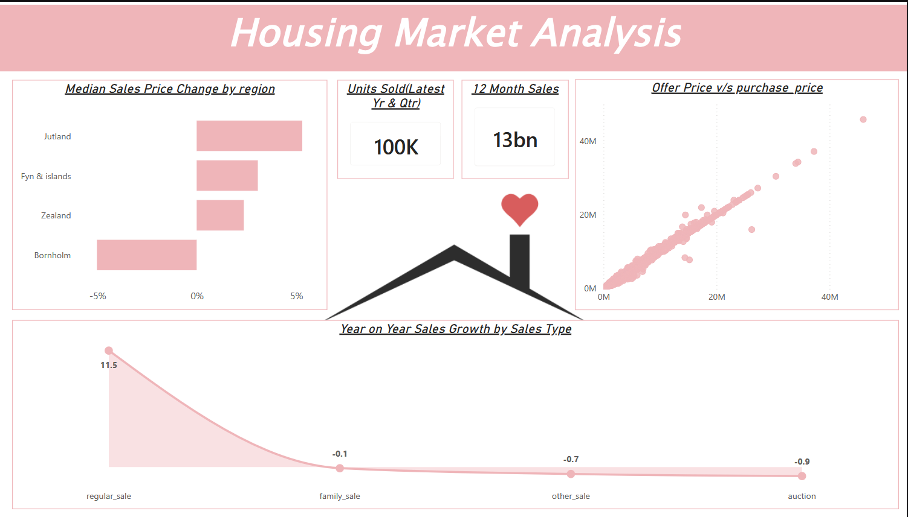
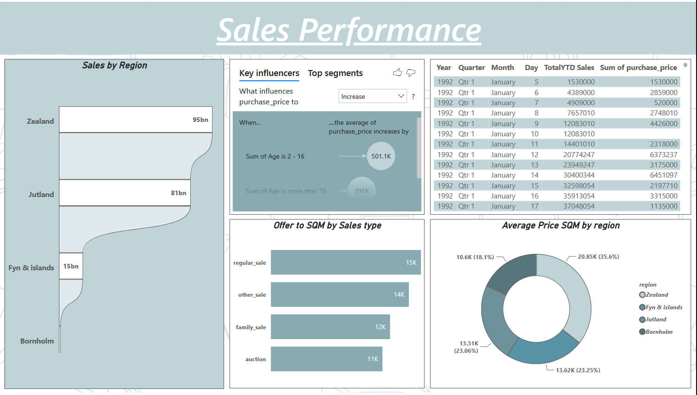
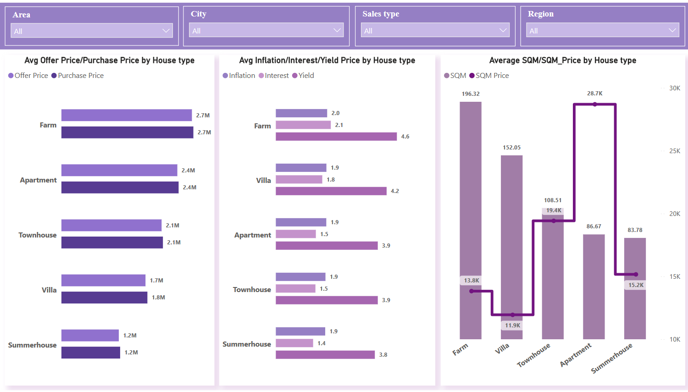

# Housing Market Analysis Dashboard

## Problem Statement

This dashboard analyzes housing market sales, prices, and property characteristics across different regions and house types. It provides insights into median sales price changes, sales activity, offer and purchase prices, yearly sales growth, and property metrics.

The dashboard is divided into three pages to explore housing market trends and sales performance.

## Dashboard Overview

### 1. Housing Market Analysis

This page provides an overview of housing sales prices and sales growth.

**Key Visuals:**
- Median Sales Price Change by Region
- Units Sold (Latest Year & Quarter)
- 12 Month Sales
- Offer Price vs Purchase Price
- Year-on-Year Sales Growth by Sales Type

**Dashboard Screenshot**

<!-- Add your first dashboard screenshot here -->



### 2. Sales Performance

This page compares sales across regions and sales types and provides detailed sales information over time.

**Key Visuals:**
- Sales by Region
- Key Influencers for Purchase Price
- Sales Table by Year, Quarter, Month, and Day
- Offer to SQM by Sales Type
- Average Price SQM by Region

**Dashboard Screenshot**

<!-- Add your second dashboard screenshot here -->



### 3. House Type Analysis

This page compares offer prices, purchase prices, inflation, interest, yield, area, and price per square metre across different house types.

**Available Filters:**
- Area
- City
- Sales Type
- Region

**Key Visuals:**
- Average Offer Price / Purchase Price by House Type
- Average Inflation / Interest / Yield Price by House Type
- Average SQM / SQM Price by House Type

**Dashboard Screenshot**

<!-- Add your third dashboard screenshot here -->



## DAX Formulas Used

The following formulas are taken from `DAX+Formulae+Housing+Data.xlsx`.

### Calculated Columns

#### 1. Age

```DAX
Age = ABS(YEAR(Housing[date (MM/DD/YYYY)].[Date]) - Housing[year_build] )
```

#### 2. Offer Price

```DAX
Offer Price = (100*Housing[purchase_price])/(100-Housing[%_change_between_offer_and_purchase])
```

### Measures

#### 3. Average Price SQM

```DAX
Average Price SQM = AVERAGE(Housing[sqm_price])
```

#### 4. Last 12 Month Sales

```DAX
Last 12 Month Sales =
CALCULATE(
    SUM(Housing[purchase_price]),
    DATESINPERIOD(
        Housing[date (MM/DD/YYYY)],
        MAX(Housing[date (MM/DD/YYYY)]),
        -12,
        MONTH
    )
)
```

#### 5. Median Sales Price Change

```DAX
Median Sales Price Change =
VAR CurrMedianPrice =
    MEDIANX(
        FILTER(
            Housing,
            YEAR(Housing[date (MM/DD/YYYY)].[Date]) =
                YEAR(MAX(Housing[date (MM/DD/YYYY)].[Date]))
        ),
        Housing[purchase_price]
    )
VAR PreMedianPrice =
    MEDIANX(
        FILTER(
            Housing,
            YEAR(Housing[date (MM/DD/YYYY)].[Date]) =
                YEAR(MAX(Housing[date (MM/DD/YYYY)].[Date])) - 1
        ),
        Housing[purchase_price]
    )
RETURN
    IF(
        PreMedianPrice <> 0,
        (CurrMedianPrice - PreMedianPrice) / PreMedianPrice,
        BLANK()
    )
```

#### 6. Offer to SQM Ration

```DAX
Offer to SQM Ration =
DIVIDE(
    SUM(Housing[Offer Price]),
    SUM(Housing[sqm])
)
```

#### 7. Sales by Region

```DAX
Sales by Region =
CALCULATE(
    SUM(Housing[purchase_price]),
    ALLEXCEPT(Housing, Housing[region])
)
```

#### 8. TotalYTD Sales

```DAX
TotalYTD Sales =
TOTALYTD(
    SUM(Housing[purchase_price]),
    Housing[date (MM/DD/YYYY)].[Date]
)
```

#### 9. Units Sold in Latest Year & Quarter

```DAX
Units sold in latest Year & Quarter =
CALCULATE(
    DISTINCTCOUNT(Housing[house_id]),
    YEAR(Housing[date (MM/DD/YYYY)]) =
        YEAR(MAX(Housing[date (MM/DD/YYYY)]))
        &&
    QUARTER(Housing[date (MM/DD/YYYY)]) =
        QUARTER(MAX(Housing[date (MM/DD/YYYY)]))
)
```

#### 10. YOY Sales Growth

```DAX
YOY_Sales_Growth =
VAR CurrYearSales =
    CALCULATE(
        SUM(Housing[purchase_price]),
        YEAR(Housing[date (MM/DD/YYYY)]) =
            YEAR(MAX(Housing[date (MM/DD/YYYY)]))
    )
VAR Prevyearsales =
    CALCULATE(
        SUM(Housing[purchase_price]),
        YEAR(Housing[date (MM/DD/YYYY)]) =
            YEAR(MAX(Housing[date (MM/DD/YYYY)])) - 1
    )
RETURN
    IF(
        Prevyearsales <> 0,
        (CurrYearSales - Prevyearsales) / Prevyearsales,
        BLANK()
    )
```

## Key Insights

- Median sales price changes are compared across Jutland, Fyn & islands, Zealand, and Bornholm.
- The dashboard displays units sold for the latest year and quarter and total sales over the latest 12 months.
- Offer prices are compared with purchase prices using a scatter plot.
- Year-on-year sales growth is compared across regular_sale, family_sale, other_sale, and auction.
- Sales performance is analyzed by region and average price per square metre.
- Property prices and characteristics are compared across different house types.

*Insights are based on the supplied dashboard PDF. Results depend on the underlying data and report context.*

## Tools Used

- Google BigQuery
- Power BI
- DAX (Data Analysis Expressions)
- Microsoft Excel

## Project Files

- `Housing Data Analysis (Google BigQuery)-1.pdf` - Dashboard reference
- `DAX+Formulae+Housing+Data.xlsx` - DAX formulas
- `README.md` - Project documentation

## Notes

- DAX formulas are based on the supplied Excel workbook.
- The formula name `Offer to SQM Ration` is preserved as written in the source workbook.
- Create an `images` folder in the repository and replace the sample image paths with your actual screenshot filenames.
